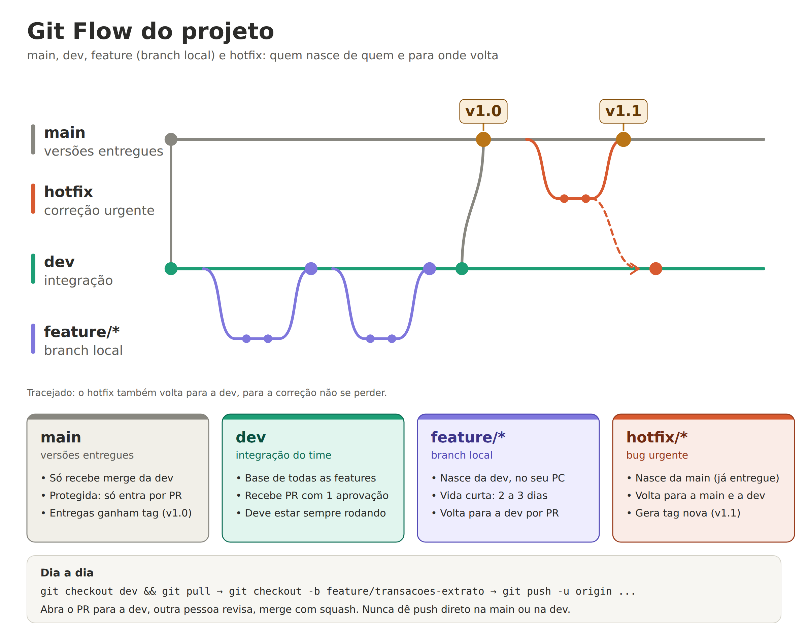

# Git Flow do projeto

Este documento explica como o grupo usa Git e GitHub neste projeto: quais branches existem, como criar e entregar uma tarefa, e as regras que todos seguem.



## 1. Branches

| Branch | Para que serve | Nasce de | Volta para |
|---|---|---|---|
| `main` | Versões entregues. Cada entrega ganha uma tag (`v1.0`, `v1.1`). | (branch inicial) | (não volta) |
| `dev` | Integração do time. É a base de todo o trabalho e deve estar sempre rodando. | `main` | `main` (na entrega) |
| `feature/*` | Branch local de uma tarefa (uma tela, uma rota, um CRUD). Vida curta: 2 a 3 dias. | `dev` | `dev` (por pull request) |
| `hotfix/*` | Correção urgente de um bug na versão que já está na `main`. | `main` | `main` e `dev` |

Regras de ouro:

- Ninguém dá `push` direto na `main` nem na `dev`. Tudo entra por pull request (PR).
- Todo PR é revisado por outra pessoa do grupo antes do merge.
- A `main` só recebe código que já passou pela `dev`, exceto `hotfix`.

## 2. Nome das branches

Padrão: `feature/<area>-<descricao-curta>`, tudo minúsculo e com hífen.

Exemplos:

- `feature/login-jwt`
- `feature/categorias-crud`
- `feature/transacoes-extrato`
- `feature/dashboard-resumo-mensal`
- `feature/contas-fixas-status`
- `feature/metas-desejos`
- `hotfix/login-token-expirado`

Divisão de áreas do grupo (troquem A, B e C pelos nomes):

| Pessoa | Áreas (tela + rotas + tabelas) |
|---|---|
| A | transações, extrato e dashboard |
| B | login, categorias e perfil (e a base do projeto) |
| C | contas fixas e metas/desejos |

## 3. Passo a passo de uma tarefa (feature)

1. Atualize a `dev` e crie a sua branch:

   ```bash
   git checkout dev
   git pull origin dev
   git checkout -b feature/transacoes-extrato
   ```

2. Trabalhe e faça commits pequenos (veja o padrão na seção 5).

3. Antes de abrir o PR, traga as novidades da `dev` para a sua branch e resolva conflitos, se houver:

   ```bash
   git pull origin dev
   ```

4. Envie a branch para o GitHub:

   ```bash
   git push -u origin feature/transacoes-extrato
   ```

5. No GitHub, abra um **pull request para a `dev`** (não para a `main`) e peça revisão a outra pessoa.

6. Depois da aprovação, faça o merge com **Squash and merge** e apague a branch.

7. Volte para a `dev` e atualize:

   ```bash
   git checkout dev
   git pull origin dev
   ```

## 4. Pull request

O PR deve ter:

- Título no mesmo padrão dos commits, por exemplo `feat: lista de transações no extrato`.
- Descrição curta: o que mudou e como testar.
- Print da tela, quando for mudança visual.

Checklist antes de pedir revisão:

- [ ] Rodei o projeto localmente e funciona.
- [ ] Atualizei a minha branch com a `dev` e não há conflitos.
- [ ] Não commitei `.env`, senhas, `node_modules` ou arquivos temporários.
- [ ] O PR é pequeno e trata de uma coisa só.

Quem revisa deve responder no mesmo dia. Revisão rápida vale mais que revisão perfeita.

## 5. Mensagens de commit

Formato: `tipo: descrição curta no imperativo`.

| Tipo | Quando usar | Exemplo |
|---|---|---|
| `feat` | Funcionalidade nova | `feat: rota de listar transações` |
| `fix` | Correção de bug | `fix: filtro de entradas no extrato` |
| `docs` | Documentação | `docs: atualiza README` |
| `refactor` | Reorganizar código sem mudar comportamento | `refactor: separa serviço de contas fixas` |
| `test` | Testes | `test: cobre login com senha errada` |
| `chore` | Configuração e tarefas gerais | `chore: adiciona .env.example` |

## 6. Entrega: da `dev` para a `main`

Quando as funcionalidades obrigatórias estiverem integradas e testadas na `dev`:

1. Confirmem que a `dev` roda do zero (clonar, configurar o `.env`, subir o back e o front).
2. Abram um PR de `dev` para `main` e peçam revisão.
3. Façam o merge com **Create a merge commit** (não use squash aqui, senão a `dev` e a `main` passam a divergir).
4. Marquem a versão:

   ```bash
   git checkout main
   git pull origin main
   git tag -a v1.0 -m "Primeira versão entregue"
   git push origin v1.0
   ```

## 7. Hotfix: bug urgente na `main`

Use `hotfix/*` apenas para bug na versão que já está na `main`. Bug encontrado só na `dev` vira uma branch `feature/*` (ou `fix/*`) normal.

1. Crie a branch a partir da `main`:

   ```bash
   git checkout main
   git pull origin main
   git checkout -b hotfix/login-token-expirado
   ```

2. Corrija, faça commit e envie com `git push -u origin hotfix/login-token-expirado`.
3. Abra **dois PRs**: um para a `main` e outro para a `dev`, para a correção não se perder. Nos dois, use **Create a merge commit**.
4. Depois do merge na `main`, crie a tag da correção (por exemplo `v1.1`).

## 8. Regras do repositório (configurar uma vez)

No GitHub, em **Settings → Branches** (ou **Rules → Rulesets**), proteger `main` e `dev` com:

- Exigir pull request antes do merge.
- Exigir 1 aprovação.
- Bloquear push direto e force push.

Em **Settings → General**, ativar a opção de apagar a branch automaticamente depois do merge.

Observação: em repositório privado, algumas regras de proteção dependem do plano do GitHub. Se não estiverem disponíveis, o grupo segue as mesmas regras por combinado.

## 9. Conflitos, arquivos compartilhados e banco

- Branches curtas geram poucos conflitos. Se a sua passar de 3 dias, quebre a tarefa em partes menores.
- Arquivos que todo mundo toca (registro das rotas no `main.py`, menu do front, models): mexam pouco, em commits pequenos, e façam o merge logo.
- Migrações do banco: uma pessoa por vez cria e faz merge; as outras atualizam a branch antes de criar a sua.
- Combinem os nomes das colunas das tabelas logo no começo e não renomeiem sozinhos.

## 10. Ritmo sugerido (menos de um mês)

| Semana | Foco |
|---|---|
| 1 | Base do projeto (repo, estrutura, banco, login e layout). As outras áreas começam com usuário fixo. |
| 2 | Cada pessoa constrói as telas, rotas e tabelas da sua área, via `feature/*` para a `dev`. |
| 3 | Integração (trocar o usuário fixo pelo login real), dashboard completo e testes. Ao final, PR da `dev` para a `main` e tag `v1.0`. |
| 4 | Só correções e documentação. Bug na versão entregue vira `hotfix/*`. Sem funcionalidade nova. |
