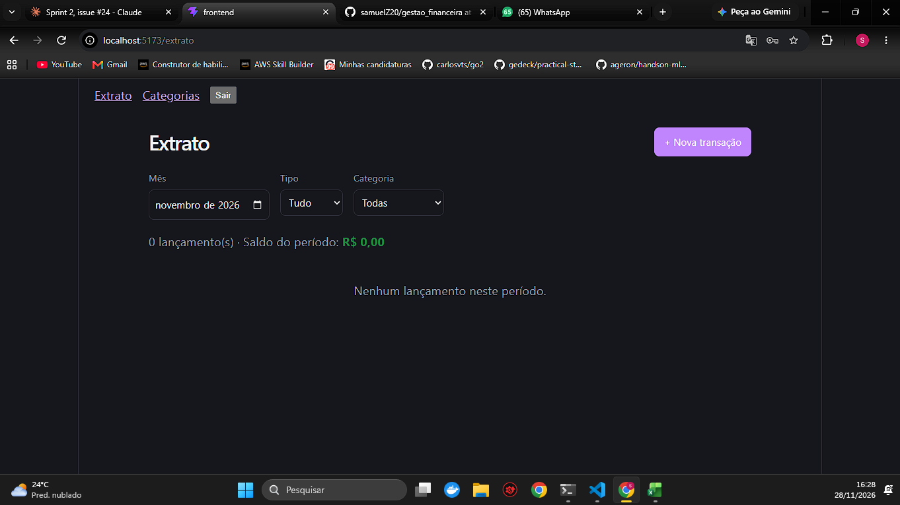
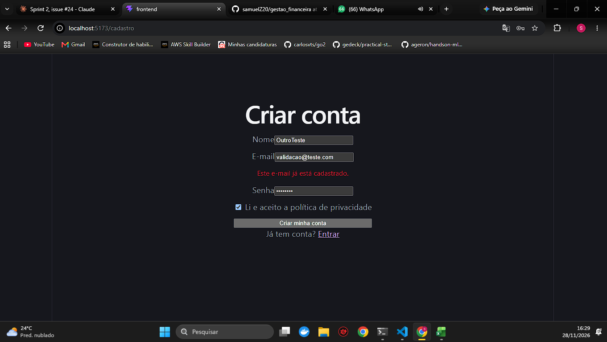
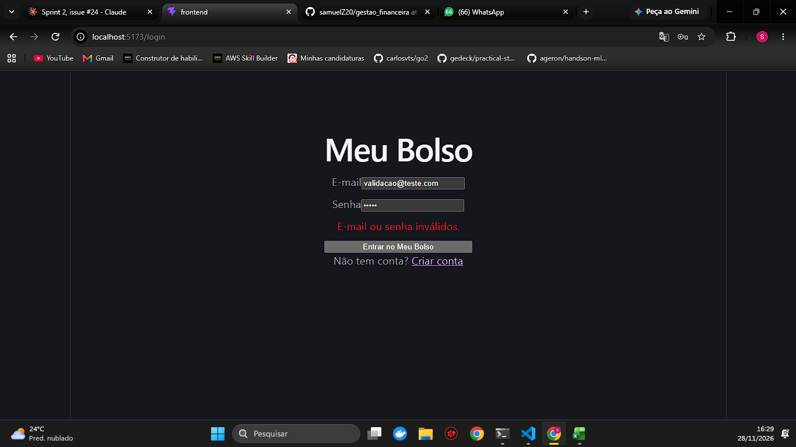
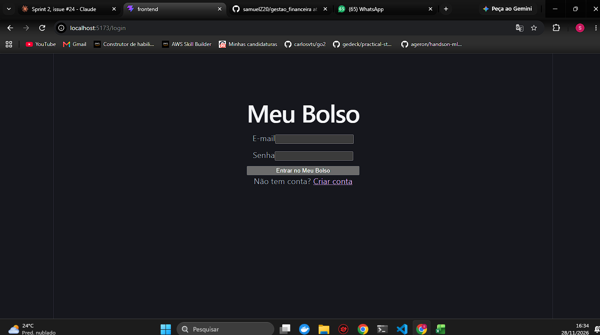
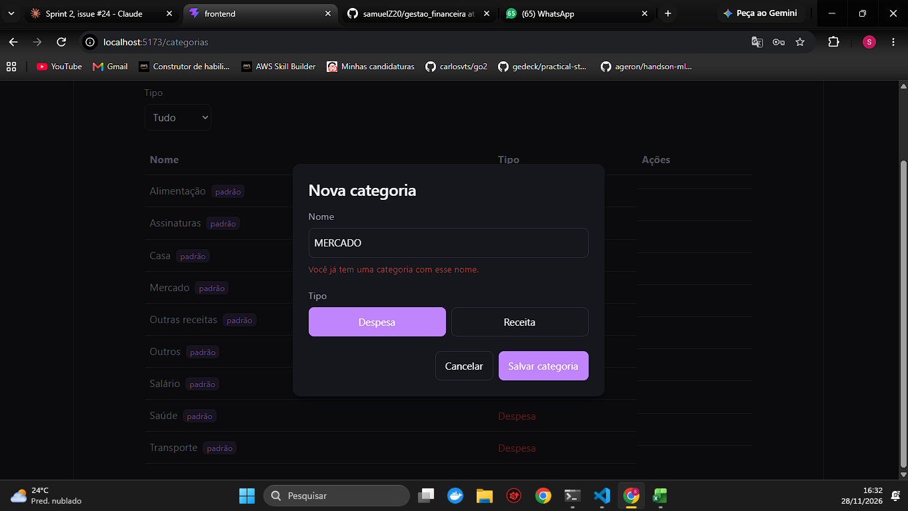
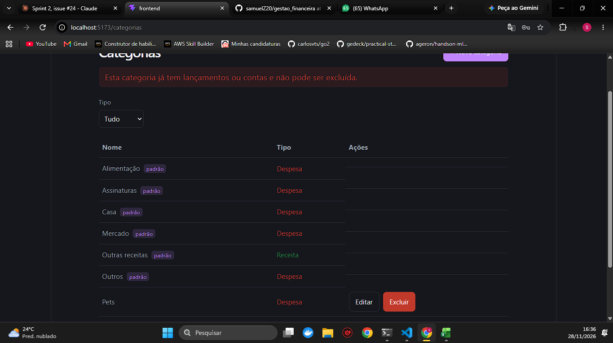

# Casos de teste de validação: Acesso e Categorias

Responsável: Samuel (pessoa A) · Versão testada: `dev` · Data da execução: __/__/2026

Ambiente: back-end com `uvicorn` (porta 8000), front-end com `npm run dev` (porta 5173), PostgreSQL no Docker. Navegador em janela anônima.

Os casos rodam em ordem: o CV-01 cria a conta usada nos seguintes.

---

## CV-01: Criar conta com dados válidos

| Campo | Conteúdo |
| --- | --- |
| Funcionalidade | RF001 Criar conta (I_Cadastro) |
| Pré-condição | O e-mail `validacao@teste.com` ainda não está cadastrado |
| Passos | 1. Abrir `http://localhost:5173` (vai para o login). 2. Clicar em **Criar conta**. 3. Preencher os campos. 4. Marcar **Li e aceito a política de privacidade**. 5. Clicar em **Criar minha conta**. |
| Entrada | Nome: `Validação` · E-mail: `validacao@teste.com` · Senha: `12345678` |
| Saída esperada | O sistema entra direto na tela **Extrato**, com o menu e o botão **Sair** |
| Saída obtida |  |
| Resultado | A preencher |

## CV-02: Cadastro com e-mail já cadastrado

| Campo | Conteúdo |
| --- | --- |
| Funcionalidade | RF001 / RN01 E-mail único (IE_CadastroEmailExistente) |
| Pré-condição | CV-01 executado; estar deslogado (clicar em **Sair**) |
| Passos | 1. No login, clicar em **Criar conta**. 2. Preencher os campos. 3. Marcar o aceite da política. 4. Clicar em **Criar minha conta**. |
| Entrada | Nome: `Outra pessoa` · E-mail: `validacao@teste.com` · Senha: `12345678` |
| Saída esperada | A conta não é criada; aparece **"Este e-mail já está cadastrado."** embaixo do campo E-mail |
| Saída obtida |  |
| Resultado | A preencher |

## CV-03: Login com senha errada

| Campo | Conteúdo |
| --- | --- |
| Funcionalidade | RF002 Entrar no sistema (IE_LoginCredenciaisInvalidas) |
| Pré-condição | CV-01 executado; estar deslogado |
| Passos | 1. Abrir `http://localhost:5173/login`. 2. Preencher e-mail e senha. 3. Clicar em **Entrar no Meu Bolso**. |
| Entrada | E-mail: `validacao@teste.com` · Senha: `senhaerrada` |
| Saída esperada | Continua na tela de login, com a mensagem **"E-mail ou senha inválidos."** |
| Saída obtida |  |
| Resultado | A preencher |

## CV-04: Acessar uma tela interna sem estar logado

| Campo | Conteúdo |
| --- | --- |
| Funcionalidade | RN17 Só usuários logados acessam o sistema |
| Pré-condição | Estar deslogado |
| Passos | 1. Digitar na barra de endereço `http://localhost:5173/categorias` e apertar Enter. |
| Entrada | Endereço `/categorias` |
| Saída esperada | O sistema não mostra Categorias e leva para a tela de **login** (`/login`) |
| Saída obtida |  |
| Resultado | A preencher |

## CV-05: Cadastrar categoria com nome repetido

| Campo | Conteúdo |
| --- | --- |
| Funcionalidade | RF006 / RN21 Nome único por tipo (IE_CategoriaDuplicada) |
| Pré-condição | Logado como `validacao@teste.com` (já tem a categoria padrão **Mercado**, de despesa) |
| Passos | 1. Clicar em **Categorias** no menu. 2. Clicar em **+ Nova categoria**. 3. Digitar o nome. 4. Deixar o tipo **Despesa**. 5. Clicar em **Salvar categoria**. |
| Entrada | Nome: `mercado` (minúsculo) · Tipo: Despesa |
| Saída esperada | A categoria não é criada; aparece **"Você já tem uma categoria com esse nome."** embaixo do campo Nome |
| Saída obtida |  |
| Resultado | A preencher |

## CV-06: Excluir categoria que tem lançamentos

| Campo | Conteúdo |
| --- | --- |
| Funcionalidade | RF009 / RN04 Categoria em uso não pode ser excluída (IE_CategoriaEmUso) |
| Pré-condição | Logado como `validacao@teste.com`; criar a categoria **Pets** (despesa) e, no **Extrato**, registrar uma despesa de R$ 50,00 na categoria Pets |
| Passos | 1. Clicar em **Categorias** no menu. 2. Na linha de **Pets**, clicar em **Excluir**. 3. Na janela **Confirmar exclusão**, clicar em **Excluir**. |
| Entrada | Categoria: Pets (com 1 lançamento) |
| Saída esperada | A categoria não é excluída; aparece o aviso vermelho **"Esta categoria já tem lançamentos ou contas e não pode ser excluída."** |
| Saída obtida |  |
| Resultado | A preencher |

---

## Resumo da execução

| ID | Funcionalidade | Resultado |
| --- | --- | --- |
| CV-01 | RF001 Criar conta | A preencher |
| CV-02 | RN01 E-mail já cadastrado | A preencher |
| CV-03 | RF002 Senha errada | A preencher |
| CV-04 | RN17 Acesso sem login | A preencher |
| CV-05 | RN21 Categoria repetida | A preencher |
| CV-06 | RN04 Categoria em uso | A preencher |
